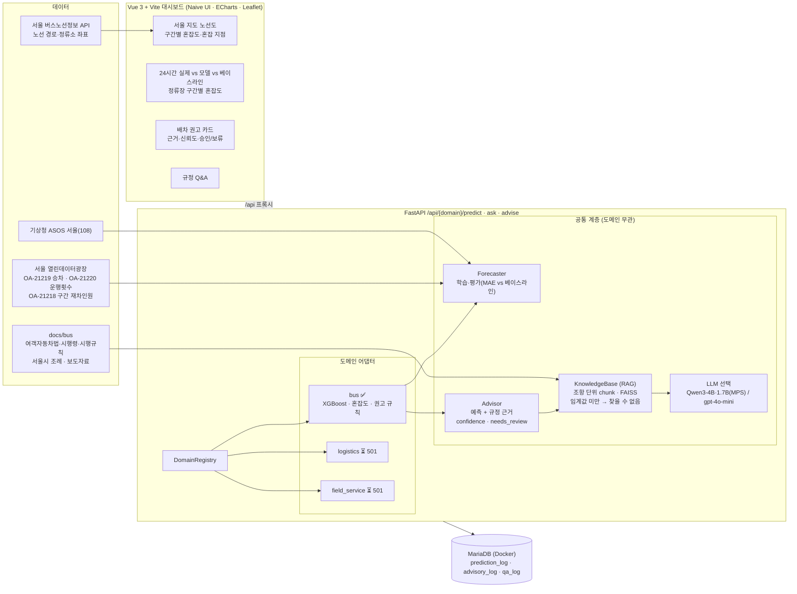

# 🚌 버스 배차 최적화 도우미 — 서비스·물류 배차 AI

> AI서비스사례연구 기말 프로젝트 · 조 **Oh!gimbak**
>
> 수요(승객 수)를 예측하고, 규정 문서(RAG)를 근거로 배차 간격·증감차를 **권고**합니다.
> AI는 보조 역할이며 **모든 권고는 `needs_review=true`** — 최종 결정은 배차 담당자가 합니다.

- **공통 아키텍처**: 수요 예측(Forecaster) · 규정 지식베이스(RAG) · 배차 권고(Advisor) + 도메인 어댑터 레지스트리
- **1차 스프린트 (구현)**: 서울 시내버스 5개 노선 (143·272·160·150·271), 2024-08-26 ~ 2026-10-25 실데이터(2년), 실측 마지막 날 + 21일 예측
- **2차 스프린트 (인터페이스만)**: 물류(화물 차량 배차) · 서비스 기사 출동 배차 → API가 `501 not_implemented` 반환

---

## 1. 아키텍처



### 요청 흐름 — `/api/bus/advise`
1. 저장된 예측(store)에서 노선·날짜·시간의 정류장별 예상 승차를 조회
2. **승차 → 구간 재차인원 환산**: 최근 8주 구간 데이터(OA-21218)로 만든 비율 × 예측 노선 승차
3. **혼잡도 = 버스 1대당 재차인원 ÷ 정원(55명)** → 여유 < 0.45 ≤ 보통 < 0.8 ≤ 혼잡 < 1.0 ≤ 매우혼잡
4. 최대 혼잡 구간 기준 권고: ≥ 0.8 증차(간격 단축, 목표 혼잡도 0.7) / < 0.25 감차 검토 / 그 외 유지
   → 노선 기본정보의 **최소·최대 배차간격 범위 안으로 제한**, 이미 최소 간격이면 "별도 대책(구간 맞춤버스 등)"
5. 권고 유형에 맞는 질문으로 **/ask와 같은 RAG 경로**를 호출해 규정 근거(문서명·조항) 첨부
6. 신뢰도(노선별 검증 오차 기반, 근거 없으면 감점) + `needs_review=true` → MariaDB 저장 → 담당자 승인/보류/반려

### 새 도메인 추가 방법 (공통 계층 수정 없음)
1. `app/domains/<name>/adapter.py`에 `DomainAdapter` 상속 클래스 작성 (`predict`, `advise`, 요청 스키마)
2. `app/domains/__init__.py`의 `register_all()`에 한 줄 등록
3. `docs/<name>/`에 규정 문서 추가 → `/api/<name>/ask` 자동 동작

---

## 2. 폴더 구조

```
ai서비스 기말과제/
├── app/                        FastAPI 백엔드
│   ├── main.py                 앱 생성·예외(501/400)·라우터 등록
│   ├── config.py               경로·모델명·임계값 (.env로 덮어쓰기)
│   ├── api/routes.py           공통 API: /api/{domain}/predict·ask·advise, 이력·검토
│   ├── core/                   ── 공통 계층 (도메인 무관) ──
│   │   ├── domain.py           DomainAdapter 인터페이스, NotImplementedDomain
│   │   ├── registry.py         도메인 레지스트리
│   │   ├── forecaster.py       Forecaster 인터페이스, MAE·개선율 계산
│   │   ├── rag.py              KnowledgeBase (문서 로드·조항 분할·FAISS·근거 기반 답변)
│   │   ├── llm.py              Qwen3(로컬) / OpenAI 선택
│   │   ├── advisor.py          권고 공통 처리 (근거·신뢰도·needs_review)
│   │   └── schemas.py
│   ├── domains/
│   │   ├── bus/                ── 1차 스프린트 ──
│   │   │   ├── data.py         wide→long 변환, 노선정보·좌표 로드
│   │   │   ├── features.py     달력·공휴일·방학·날씨·lag 피처
│   │   │   ├── forecaster.py   XGBoost 학습·시간순 분할·배치 추론
│   │   │   ├── advisor.py      혼잡도·권고 규칙
│   │   │   └── adapter.py      버스 어댑터 + 지도용 API
│   │   ├── logistics/          인터페이스·스키마만 (501)
│   │   └── field_service/      인터페이스·스키마만 (501)
│   └── db/                     SQLAlchemy async 모델·저장소
├── scripts/                    데이터 수집·학습·인덱싱 CLI
├── frontend/                   Vue 3 + Vite 대시보드
├── docs/bus/                   RAG 규정 문서 (PDF·TXT)
├── docker/                     MariaDB (교수님 maria_db.yml 템플릿 기반)
├── tests/                      pytest (합성 데이터)
└── data/ models/ vectorstore/ hf_models/   ← 생성물, 커밋 제외
```

---

## 3. 실행 방법

### 3-0. 사전 준비
| 항목 | 비고 |
|---|---|
| Python 3.11 | `python3.11 --version` |
| Node.js 20+ | 프론트엔드 |
| Docker Desktop | MariaDB |
| `brew install libomp` | macOS에서 XGBoost 실행에 필요 |
| (선택) 공공데이터포털 인증키 | 실데이터 날씨·노선 좌표 수집 시 |

### 3-1. 설치
```bash
cd "ai서비스 기말과제"
python3.11 -m venv .venv
source .venv/bin/activate
pip install -r requirements.txt
cp .env.example .env          # 키 입력 (OpenAI는 선택)
cd frontend && npm install && cd ..
```

### 3-2. 빠른 실행 — 합성 데이터만으로 (실데이터·API 키 없이)
```bash
python scripts/make_sample_data.py           # data/sample 생성 (실데이터와 같은 스키마 + 가상 노선 좌표, 60주)
python scripts/train_bus.py --mode sample    # 학습 → 모델/베이스라인 MAE·개선율 출력
python scripts/build_index.py                # 규정 문서 FAISS 인덱스 (bge-m3 최초 1회 다운로드 ~2.3GB)
```
`.env`에서 `DATA_MODE=sample`로 바꾼 뒤 아래 3-4로 서버를 띄웁니다. (실데이터가 없으면 `auto`도 sample로 동작)

### 3-3. 실데이터로 실행
1. **노선 기본정보 엑셀(수동)**: [서울 열린데이터광장](https://data.seoul.go.kr)에서 「서울시 버스노선 기본정보」, 「서울시 버스노선 ID 정보」를 받아 `data/raw/`에 저장
   - `서울시버스노선기본정보(20260902).xlsx`, `서울시버스노선ID정보(20260902).xlsx`
2. 나머지는 스크립트가 받습니다.
```bash
python scripts/download_seoul_bus.py         # OA-21219·21220 최근 1년치 + OA-21218 8주치, 노선 필터링 후 원본 삭제 (~1.5GB 다운로드 → 18MB)
# 과거 1년치 (작년 같은 주 피처용) → data/interim/*_history.parquet
python scripts/download_seoul_bus.py --datasets OA-21219 OA-21220 \
    --seqs 2408 2409 2410 2411 2412 2501 2502 2503 2504 2505 2506 2507 2508 2509 \
    --min-date 20240826 --max-date 20250928 --suffix _history
python scripts/fetch_weather.py --start 2024-08-01   # 기상청 ASOS 서울 시간자료 (DATA_GO_KR_API_KEY 필요)
python scripts/fetch_route_geo.py            # 노선 경로·정류소 좌표 (DATA_GO_KR_API_KEY 필요)
python scripts/train_bus.py --mode real      # 약 7분 (M 시리즈, 2년치 844만 행)
python scripts/build_index.py
```

### 3-4. 서버 실행
```bash
# MariaDB (Docker Desktop 실행 후)
cp docker/.env.example docker/.env
docker compose -p dispatch_ai -f docker/maria_db.yml up -d

# 백엔드 (프로젝트 루트)
python -m uvicorn app.main:app --port 8000      # API 문서: http://localhost:8000/docs

# 프론트엔드 (새 터미널)
cd frontend && npm run dev                      # http://localhost:5173
```
- DB가 꺼져 있어도 API는 동작하고 응답에 `"db_saved": false`가 붙습니다.
- 로컬 LLM은 첫 질문 때 로드됩니다. 기본 Qwen3-1.7B(~4GB), `.env`의 `LOCAL_MODEL_NAME=Qwen/Qwen3-4B` 권장(~8GB, 처음 한 번 `HF_HUB_OFFLINE=0`으로 다운로드). Apple Silicon MPS에서 답변 약 5~10초.
- LLM을 `openai`로 고르면 `.env`의 `OPENAI_API_KEY`가 필요합니다. 없으면 400과 함께 안내 문구를 반환합니다.

### 3-5. 테스트
```bash
python -m pytest -q      # 합성 데이터 기준 11개: 시간순 분할·lag 누수·지표·API 계약·501·OpenAI 키 오류
```

---

## 4. 데이터

| 데이터 | 출처 | 사용 |
|---|---|---|
| OA-21219 정류장별 승차 승객수 (1일 1시간) | 서울 열린데이터광장 | **예측 대상 y** |
| OA-21220 정류장별 운행횟수 (1일 1시간) | 〃 | 피처(배차 계획) · 혼잡도 분모 |
| OA-21218 구간별 재차인원 (1일 1시간) | 〃 (최근 8주) | 승차 → 구간 재차인원 환산 비율 |
| 버스노선 기본정보 · 노선ID | 〃 (엑셀) | 기준 배차간격, 최소·최대 배차, 인가대수, 운행시간 |
| 기상청 ASOS 서울(108) 시간자료 | 공공데이터포털 API | 기온·강수·습도 피처 |
| 버스노선정보조회 (노선 경로·정류소) | 공공데이터포털 API (`ws.bus.go.kr`) | 지도 |
| 한국 공휴일 | `holidays` 패키지 | 공휴일·연휴 전날 피처 |

- **OA-12913**(월 단위 합계): 시간대 정보가 없어 학습에 사용하지 않음 (보조 확인용)
- **OA-21217**(구간 운행시간): 2025년 12월 이후 갱신이 멈춰 기간이 맞지 않아 제외
- **원천 결측일**: 승차 18일, 운행 24일이 원천 파일에 없음 (예: 2025-11-28 ~ 12-04) → 0이 아닌 결측으로 처리
- **원천 이상일 (행은 있지만 값이 비정상)** — 원 규칙(빈칸 = 0명)을 그대로 쓰면 "하루 승객 0명"으로 학습·평가되므로 자동 탐지해 결측 처리
  (`BusDataset.find_anomalies`, 화면에 "실측 제외" 안내)

  | 날짜 | 상태 | 판정 |
  |---|---|---|
  | 2026-09-29, 10-01 | 버스는 평소처럼 운행, 승차 값만 24시간 전부 빈칸 | 승차 집계 누락 |
  | 2026-01-13 ~ 14 | 운행횟수·승차 모두 평소의 10~20% 미만 | 운행 중단(파업 추정) |
  | 2026-05-18 | 운행횟수 값만 전부 빈칸 | 운행 집계 누락 |
- **공공데이터포털에서 신청한 서비스**: 서울특별시_버스노선정보조회, 서울특별시_버스위치정보조회(2차 스프린트 실시간용), 서울특별시_정류소정보조회, 기상청_지상(종관, ASOS) 시간자료 조회서비스

### RAG 문서 수집 (`docs/bus/`)
| 문서 | 받는 곳 |
|---|---|
| 여객자동차 운수사업법 · 시행령 · 시행규칙 | [국가법령정보센터](https://www.law.go.kr) → 법령 검색 → 저장(PDF) |
| 서울특별시 시내버스 준공영제 운영 조례, 재정지원 및 안전 운행기준 조례, 정류소 정비·관리 조례, 용산구 버스노선조정위원회 조례 | [자치법규정보시스템](https://www.elis.go.kr) → PDF |
| 서울시 교통 보도자료 8건 (다람쥐버스, 혼잡도 안내, 노선 조정, 집중배차 등) | `python scripts/fetch_press_docs.py` (교통분야 누리집·내 손안에 서울) |

- PDF는 텍스트 추출이 가능한 파일이어야 합니다 (스캔 이미지 X). 파일명이 답변의 **출처 문서명**으로 표시됩니다.
- 법령 PDF는 목차와 부칙을 제외하고 **조항(제N조) 단위**로 나눠 인덱싱합니다. `docs/`가 바뀌면 다음 질의 때 인덱스를 자동 재생성합니다.
- 서울시의 배차간격·증차 "내부 지침" 원문은 공개본이 없어, 권고 근거는 법령(사업계획 변경 기준)과 정책 사례(보도자료)로 제시합니다.

---

## 5. 수요 예측 모델

- **y**: 노선·정류장·시간대별 승차 승객 수
- **X**: 노선·정류장(범주형), 정류장 순서, 시간, 요일, 주말, 공휴일, 연휴 전날, 방학, 기온·강수·습도, 운행횟수(배차 계획),
  **3~6주 전(21·28·35·42일 전) 같은 요일·시간 승객 수와 평균**, **작년 같은 주(357·364·371일 전)와 평균, 작년 그날의 공휴일 여부**
- **모델**: XGBoost 단독 (`hist`, 범주형 직접 처리, early stopping), 학습 2년치(2024-10 ~ 2026-08)
- **베이스라인**: 작년 같은 요일·같은 시간대 승객 수 (21일 앞 예측에서도 항상 알 수 있는 값)

### 왜 "21일 앞" 예측인가 — 데이터 공개 시차
서울시 승객 데이터(OA-21219)는 **주 단위로, 주가 끝나고 8일 뒤 월요일에 공개**됩니다 (예: 10/12~18 주 → 10/26 공개).
그래서 어느 날이든 가장 최근 실측이 8~14일 전입니다. 처음 버전처럼 "1주 전 같은 요일" 값을 입력으로 쓰면
실측 마지막 날 + 7일까지만 예측돼 **오늘을 예측할 수 없었습니다.**
입력을 모두 21일 이상 과거 값으로 바꿔 **실측 마지막 날 + 21일**(현재 10/25 → 11/15)까지 예측합니다.
새 주 데이터가 공개될 때 다운로드·재학습하면 예측 구간도 1주씩 앞으로 이동합니다. (아래 '데이터 갱신' 참고)

### 설정 비교 실험 (10/18까지 데이터 기준, 같은 검증 행 48만 건, 원천 이상일 제외)
| 설정 | 정류장·시간 MAE | 노선·시간 MAE | 추석 주간 노선·시간 |
|---|---|---|---|
| 베이스라인: 전주 같은 요일 *(공개 시차로 실제 운영 불가)* | 6.02명 | 220명 | 544명 |
| 베이스라인: 작년 같은 요일 | 6.02명 | 208명 | 541명 |
| (이전) 1~4주 전 lag, 학습 1년, 7일 앞 | 3.94명 | 93명 | – |
| A 3~6주 전만, 학습 1년 | 4.01명 | 100명 | 186명 |
| B 3~6주 전 + 작년 같은 주, 학습 1년 | 3.98명 | 93명 | 190명 |
| C 작년 같은 주만, 학습 1년 *(장기 예측 후보)* | 4.03명 | 91명 | 203명 |
| D 3~6주 전만, 학습 2년 | 3.93명 | 92명 | 163명 |
| **E 3~6주 전 + 작년 같은 주, 학습 2년 ← 채택** | **3.91명** | **85명** | **157명** |

- 예측 거리만 바꿨을 때(정제 데이터): 7일 3.94 → 14일 3.97 → 21일 3.98 → 28일 4.00명 — 21일 앞으로 늘려도 손실 1% 수준
- 최근 자료가 "지금 수준"(중요도 0.69), 작년 자료가 계절·연휴 패턴을 보정하고, 학습 2년이 추석을 두 번 보게 해 연휴 오차를 크게 줄였습니다.
- 추석 당일처럼 1년에 한 번 오는 날은 여전히 과대 예측(143번 9/25 하루 실제 1.76만 명, 예측 2.49만 명)하는 한계가 있습니다.

### 시간 순서 분할 (무작위 분할 없음)
| 구간 | 기간 | 용도 |
|---|---|---|
| train | 2024-10-07 ~ 2026-08-17 | 학습 (최근 lag 42일이 생기는 날부터) |
| early stop | 2026-08-18 ~ 2026-08-31 | 트리 수 결정 (검증 구간은 보지 않음) |
| **valid** | **2026-09-01 ~ 2026-10-25** | 최종 평가 (추석 연휴 포함) |
| forecast | 2026-10-26 ~ 2026-11-15 | 향후 21일 예측 (가장 최근 같은 요일 운행횟수를 배차 계획으로 가정) |

- 누수 방지: 모든 lag는 21일 이상 과거 값(테스트로 검증), 학습 코드에서 `train.max < early.min ≤ early.max < valid.min`을 assert
- 미래 날씨: 11/06까지는 ASOS 관측, 그 이후는 작년 같은 시기(±3일) 시간대 평균 (기상청 단기·중기예보 API를 신청하면 예보로 교체 가능)

### 데이터 갱신 (주 1회)
주간 파일은 매주 월요일 공개됩니다. seq는 공개일(YYMMDD)이며, 받은 뒤 서버를 재시작합니다.
모델 학습 구간은 2026-08-17까지로 고정되어 있어, 새 데이터는 lag 입력과 혼잡도 비율을 통해 반영됩니다.
```bash
python scripts/download_seoul_bus.py --seqs 261109 --append   # 10/26~11/01 주 → boarding·dispatch·section에 추가
python scripts/fetch_weather.py --start 2024-08-01
python scripts/train_bus.py --mode real
```

### 검증 결과 (실데이터, `models/bus/real/metrics.json`)
| 단위 | 모델 MAE | 베이스라인(작년 같은 요일) | 개선율 |
|---|---|---|---|
| 정류장·시간대 (n=558,499) | **3.90명** | 5.93명 | **34.3%** |
| 노선 전체·시간대 합계 (n=5,728) | **81.9명** | 191.5명 | **57.2%** |
| 평일 / 토요일 / 일·공휴일 (정류장·시간) | 4.03 / 4.15 / 3.48명 | 5.90 / 5.68 / 6.10명 | 31.6 / 26.8 / 42.9% |

참고: 같은 행에서 "전주 같은 요일" 값의 MAE는 5.92명(정류장·시간) / 206명(노선·시간)입니다.

**이 수치를 읽을 때 주의할 점**
- 개선율 57%는 추석 영향이 큽니다. 2025년 추석(10/6)과 2026년 추석(9/25)의 날짜가 달라 '작년 같은 요일' 값이 크게 빗나가는 3주가 포함돼 있습니다.

| 주 (노선·시간 MAE) | 모델 | 작년 같은 요일 |
|---|---|---|
| 9/7~13 | 67.6명 | 90.4명 |
| 9/21~27 (추석) | 131.6명 | 407.5명 |
| 10/5~11 (작년 추석) | 73.5명 | 487.5명 |
| 10/19~25 | 67.0명 | 87.4명 |

- 추석 영향이 없는 주의 개선 폭은 23~43%이며, 연휴 전후에 모델의 강점이 큽니다.
- 검증은 실제 운행횟수를 입력으로 씁니다. 실제 예측에서는 운행횟수를 모르므로 '최근 같은 요일 값'으로 가정하며, 그만큼 오차가 조금 큽니다.

**실제 예측 검증 (재학습 전 모델, 2026-10-19 ~ 25)** — 10/18까지의 데이터로 미리 만들어 둔 예측을 나중에 공개된 실측과 비교했습니다. (같은 76,719행)

| 단위 | 실제 예측 | 검증 방식(실제 운행횟수 사용) | 작년 같은 요일 |
|---|---|---|---|
| 정류장·시간대 | **4.09명** | 3.90명 | 5.43명 |
| 노선 전체·시간대 합계 | **75.2명** | 67.1명 | 87.5명 |

일별 승객 합계 오차는 -3.3 ~ +3.3%, 주간 합계는 +1.05%입니다.

> 합성 데이터 결과(참고, 60주 생성): 정류장·시간대 MAE 2.88 vs 5.11명 (개선 43.6%)

---

## 6. API

| 메서드 | 경로 | 설명 |
|---|---|---|
| GET | `/api/domains` | 등록 도메인·상태 |
| GET | `/api/{domain}/schema` | 도메인별 요청 스키마 |
| POST | `/api/{domain}/predict` | 수요 예측 `{"route":"143","date":"2026-10-13","hour":8}` |
| POST | `/api/{domain}/ask` | 규정 질의응답 `{"question":"…","llm":"qwen","embedding":"bge"}` → 답변 + 출처(문서명·조항·쪽) / 근거 없으면 `found:false`, "찾을 수 없음" |
| POST | `/api/{domain}/advise` | 배차 권고 `{"route":"143","date":"2026-10-13","hour":7,"use_llm":true}` → 예상 승객·혼잡도·권고 간격·추가 차량·근거·신뢰도·`needs_review` |
| POST | `/api/bus/advise/all` | 선택 시간대 **전체 노선** 권고 `{"date":"2026-10-28","hour":8}` → 증차 필요 → 별도 대책 → 감차 검토 → 유지 순 (규정 근거는 권고 유형별 1회 조회) |
| GET | `/api/advisories/batches` | 권고 이력 — 시간대별 "전체 노선 권고" 묶음 (권고 유형별 건수, 검토 진행) |
| GET | `/api/advisories/batches/{id}` | 묶음 1건의 노선별 저장된 권고 (현재 검토 상태 반영) |
| GET | `/api/advisories` | 개별 권고 이력 (MariaDB) |
| GET | `/api/advisories/{id}` | 저장된 권고 1건 (생성 당시 응답 전체 + 검토 상태) |
| POST | `/api/advisories/{id}/review` | 담당자 검토 `{"status":"approved|held|rejected"}` |
| GET | `/api/bus/meta`, `/api/bus/overview`, `/api/bus/routes/{route}/geometry·timeseries·stops` | 지도·차트용 |

`logistics`, `field_service`의 predict/advise(문서가 없을 때 ask 포함)는 `501 {"status":"not_implemented"}`를 반환합니다.

---

## 7. 프론트엔드 (Vue 3 + Vite)

화면 구성: 도메인 선택(물류·서비스 "준비 중") · LLM/임베딩 선택 · 날짜·시간 슬라이더(재생, "지금" 버튼) · **서울 지도 노선도(구간별 혼잡도 색, 혼잡 지점 빨간 점)** · 노선 목록 · 모델 성능 카드 · 24시간 실제/모델/베이스라인 그래프(아무 곳 클릭 → 해당 시간) · 정류장 구간별 혼잡도 · 선택 노선 배차 현황·추가 배차 필요성 · **배차 권고 탭: 선택 시간대 전체 노선 권고 목록**(노선 클릭 → 지도 선택 + 근거·신뢰도·승인/보류/반려 카드) · 규정 Q&A · **권고 이력**(시간대별 묶음 1건씩 · 클릭 → 그 시간대 노선별 저장된 권고 + 날짜·시간 이동, 검토 진행 n/5)

### UI 템플릿·라이브러리 선택 이유
조사한 후보 (2026-10 기준, GitHub API·npm 확인)

| 후보 | 라이선스 | 검토 결과 |
|---|---|---|
| vue-element-admin (★90k) | MIT | Vue 2 기반, 2024년 이후 갱신 정체 → 제외 |
| vue-vben-admin (★33k) | MIT | 모노레포·권한·다국어까지 포함한 대형 템플릿, 데모 규모에 과함 |
| vue-pure-admin (★20k) | MIT | Element Plus 기반 풀 어드민, 마찬가지로 과함 |
| soybean-admin (★15k) | MIT | **Naive UI 기반** 깔끔한 레이아웃 — 레이아웃 아이디어만 참고 |
| **Naive UI** 2.45 | **MIT** | ✅ 선택: Vue 3 전용, TypeScript, 트리셰이킹, 날짜·슬라이더·탭·접기 등 필요한 컴포넌트 완비, 테마 토큰으로 색 일관성 |
| **ECharts** 6 + vue-echarts 8 | **Apache-2.0 / MIT** | ✅ 차트: 툴팁·기준선(markLine)·SVG 렌더 |
| **Leaflet** 1.9 | **BSD-2-Clause** | ✅ 지도: 키 없이 폴리라인·마커 |
| Esri World Light Gray Canvas | Esri 이용약관 (출처 표기) | 배경지도. CARTO 무료 타일은 현재 API 키를 요구해 교체 |

→ 무거운 어드민 템플릿 대신 **Naive UI 컴포넌트 + 직접 구성한 3단 레이아웃**을 택했습니다. 이번 과제의 핵심 화면이 지도·차트·권고 카드라서 로그인·권한·라우팅이 필요 없고, 의존성이 적어야 설치·발표가 안정적이기 때문입니다. 모든 라이브러리는 MIT/Apache-2.0/BSD 계열로 과제·비상업 사용에 제약이 없습니다.

색 규칙: 혼잡 단계는 상태 팔레트(여유 초록·보통 노랑·혼잡 주황·매우혼잡 빨강)를 쓰고 항상 라벨과 함께 표시, 그래프 계열색(실제·모델·베이스라인)은 색각이상 대비 검증을 통과한 조합을 사용했습니다.

### LLM 튜닝 — 정확도 + "모르면 모른다" (환각 방지)
평가 세트 `eval/rag_eval.json` 20문항 (배차 실무자 질문 12 + 문서에 답이 없는 질문 8, 함정 질문 포함:
"혼잡도 80% 넘으면 과태료는?", "부산 준공영제 재정지원 규모는?" 등). 채점은 `scripts/eval_rag.py`가 키워드로 자동 판정,
결과는 `eval/results/*.json`에 질문·답변·출처 전체 저장.

| 단계 | 답변 정확 | 거절 정확 | 환각 | 20문항 시간 |
|---|---|---|---|---|
| 1. 기준선 (Qwen3-1.7B, 조 단위 청크) | 9/12 | 6/8 | **2** | 93초 |
| 2. 조항 계층 분할 + 프롬프트 강화 (1.7B) | 6/12 | **8/8** | **0** | 109초 |
| 3. 2 + **Qwen3-4B** ✅ 채택 | **10/12** | **8/8** | **0** | 128초 |
| 4. 2 + 1.7B LoRA 파인튜닝 (55건, 3 epoch) | 6/12 | 8/8 | 0 | 48초 |

- **1 → 2 (환각 제거)**: 긴 조문을 항(①)·호(1.)·목(가.) 단위로 나누고 상위 문장을 함께 붙여(빵부스러기) 검색 정확도를 높이고,
  프롬프트에 "근거의 대상(시내/시외/택시·지역)이 질문과 다르면 쓰지 말 것", "답할 수 없으면 정해진 문장 그대로" 규칙을 추가.
  "명시되지 않았습니다" 같은 우회 표현도 `NOT_FOUND_HINTS`로 잡아 '찾을 수 없음'으로 통일.
  기준선이 지어내던 과태료 금액(R6)이 사라졌지만, 1.7B는 **근거가 있는데도 거절**하는 과잉 거절(A9·A10·A12)이 생김.
- **3 (채택)**: 같은 프롬프트로 4B는 과잉 거절이 사라지고 환각 0 유지. MPS에서 질문당 약 6초로 1.7B와 큰 차이 없음 → `.env`의 `LOCAL_MODEL_NAME=Qwen/Qwen3-4B`.
- **4 (LoRA)**: 수업 PEFT 실습 방식(r=16, 답변 토큰만 손실, `scripts/build_lora_data.py` → `scripts/finetune_lora.py`). 학습 데이터는
  평가에 쓰지 않은 조항으로 만든 답변 31 + 거절 24건(실제 검색 결과를 근거로 사용). 과잉 거절은 고쳤지만(A9·A10·A12 정답),
  학습 정답을 한 문장(평균 68자)으로 써서 **답이 짧아지며 조건이 누락**(하반기 기한, 휴식시간 예외 등). → 데이터 55건으로는 형식은 배우지만
  내용 완결성은 4B 교체가 더 효과적. 어댑터는 `LOCAL_ADAPTER`로 켤 수 있음.
- **남은 오류 (4B)**: A10 "배차간격 단축은 인가 대상" — 정답은 신고(시행규칙 제33조). A12는 시외버스 30%·20%는 맞혔으나 기본 10%를 누락.
  검색은 20문항 모두 올바른 조항을 1순위로 찾았고 오류는 조문 해석 단계 → 모든 답변에 출처 원문을 함께 표시하고 담당자 검토를 전제로 함.

```bash
python scripts/eval_rag.py --name my_run --model Qwen/Qwen3-4B          # 평가
python scripts/build_lora_data.py && python scripts/finetune_lora.py    # LoRA (MPS 약 4시간)
python scripts/eval_rag.py --name my_lora --adapter models/llm/qwen3-1.7b-rag-lora
```

---

## 8. 검증 체크리스트

| 항목 | 결과 |
|---|---|
| 새 venv 설치 후 README 절차대로 백엔드·프론트 실행 | ✅ |
| 샘플 데이터만으로 학습 → /predict → /ask → /advise | ✅ (`pytest` 자동 검증) |
| 모델 MAE · 베이스라인 MAE · 개선율 출력·저장 | ✅ 학습 로그 + `metrics.json` |
| 시간 순서 분할 (미래 누수 없음) | ✅ assert + 테스트 |
| /ask 출처 첨부, 근거 없는 질문 "찾을 수 없음" | ✅ 유사도 임계값(bge 0.55) + LLM 판단 2단계 |
| /advise: 예상 승객·혼잡도·권고 간격·근거·needs_review | ✅ |
| Qwen3 ↔ OpenAI 전환, 키 없으면 명확한 오류 | ✅ 400 `OPENAI_API_KEY가 설정되지 않았습니다…` |
| logistics·field_service "미구현" 응답 | ✅ 501 |
| 예측·권고 MariaDB 저장 | ✅ `prediction_log`, `advisory_log`, `advisory_batch`, `qa_log` |
| GitHub private, .env·데이터·모델 미커밋 | ✅ `.gitignore` |

---

## 9. 한계와 다음 단계

- **macOS OpenMP 충돌**: xgboost(Homebrew libomp)와 torch(내장 libomp)를 한 프로세스에 올리면 segfault → 학습 스크립트는 torch 없이, API 서버는 xgboost 없이 동작하도록 분리하고 **예측은 학습 시 배치로 미리 계산**합니다 (향후 21일 포함).
- 운행횟수를 "사전에 정해진 배차 계획"으로 보고 같은 시간대 값을 피처로 사용합니다. 미래 날짜는 실측 기간 중 가장 최근 같은 요일 값을 계획으로 가정합니다.
- 새 주 데이터 공개(매주 월요일) → 다운로드·재학습은 현재 수동입니다. 스케줄러로 자동화하면 예측 구간이 매주 자동으로 갱신됩니다.
- 혼잡도는 승차 예측에 구간 환산 비율(최근 8주 평균)을 곱해 추정하므로, 노선 개편·이벤트 등 구조 변화에는 둔감합니다. 정원 55명·임계값은 `app/config.py`에서 조정합니다.
- 로컬 LLM(Qwen3-4B)도 조문 해석 오류가 남아 있어(평가 12문항 중 2개), 출처 조항 원문(스니펫)을 함께 보여 줍니다. (7장 "LLM 튜닝" 참고)
- 2차 스프린트: 버스위치정보 API로 실시간 차량 위치 오버레이, 물류·출동 도메인 어댑터 구현.
