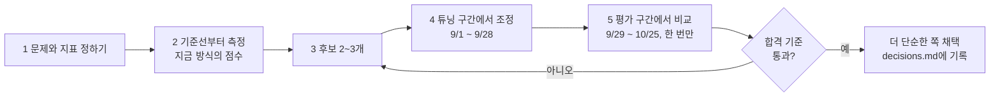
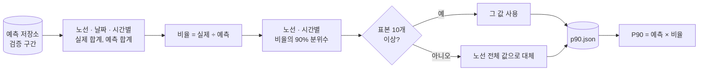
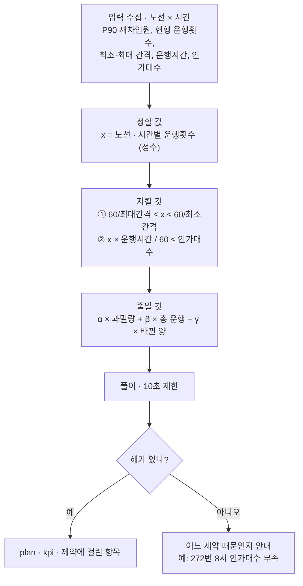
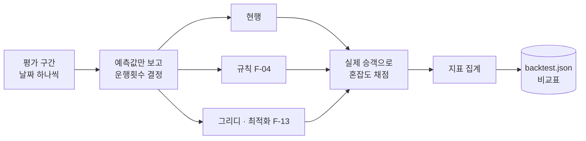
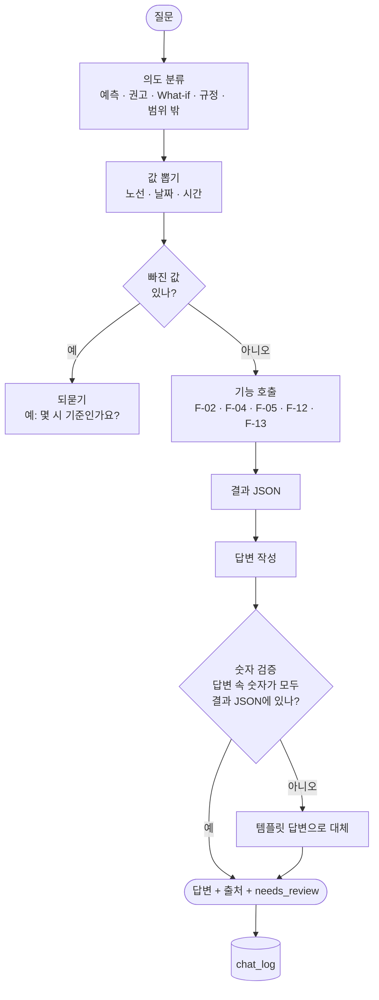
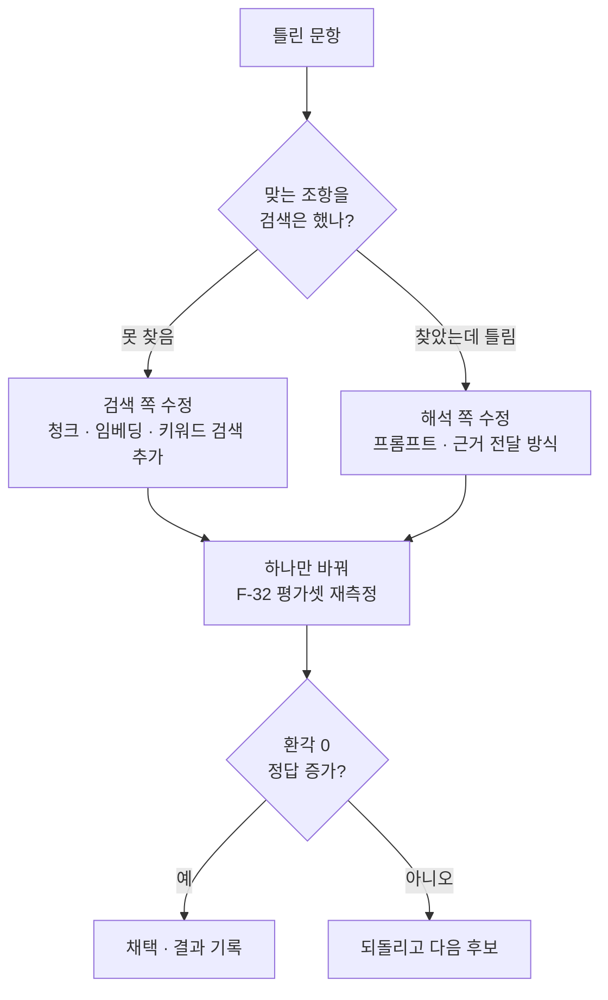
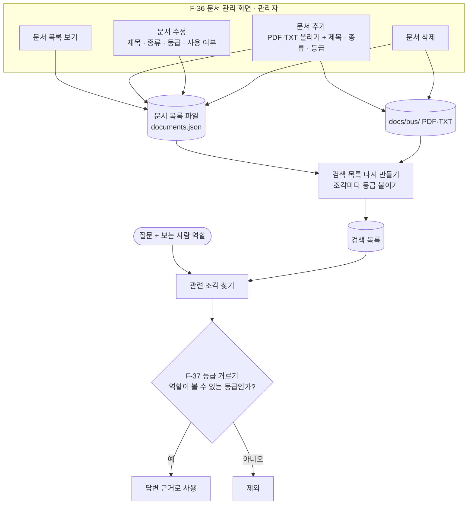

# 기능별 설계와 알고리즘 결정

새로 만드는 기능 중 설계를 결정해야 하는 7개를 다룹니다. 기능마다 내부 흐름, 후보, 합격 기준, 결정 방법, 기본안 순서로 적었습니다. 기본안은 실험 전에 시작할 출발점이고, 최종 선택은 결정 방법대로 측정한 뒤 정합니다.

## 알고리즘을 정하는 방법 (공통)

- 합격 기준은 실험 전에 적어 둡니다. 결과를 보고 기준을 바꾸지 않습니다.
- 검증 기간(9/1~10/25)을 둘로 나눕니다. 앞쪽에서 값을 고르고 뒤쪽에서는 채점만 합니다. 뒤쪽 결과를 보고 다시 고르면 발표 숫자가 부풀려집니다.
- 점수가 비슷하면 단순하고 설명하기 쉬운 쪽을 고릅니다.
- 결정은 `docs/decisions.md`에 한 줄씩 남깁니다: `날짜 | 기능 | 후보 | 평가 결과 | 채택 | 이유`.
- 선례: 기존 승객 예측(F-02)도 설정 6개를 같은 48만 행으로 비교해 "3~6주 전 + 작년 같은 주, 학습 2년" 안을 골랐습니다(README 5장).

## F-11 승객 수 상한 예측

**난이도 ★★☆☆☆** (F-11) 표 데이터 집계 한 번. 기존 예측 결과를 그대로 씀

P90은 "10번 중 9번은 이 숫자보다 적게 탄다"는 값입니다. 예측이 900명이고 P90이 1,000명이면, 평소엔 900명 안팎이지만 많이 몰려도 1,000명을 넘는 날은 열흘에 하루 정도라는 뜻입니다. 버스가 모자라면 승객이 못 타지만 조금 남는 건 괜찮으니, 증차 판단은 평균(900)이 아니라 P90(1,000) 기준으로 합니다.

| 후보 | 방식 | 장점 | 단점 |
|---|---|---|---|
| A 비율 보정 | 실제÷예측 비율의 90% 분위수를 곱함 | 재학습 없음, 하루면 구현 | 표본이 적은 시간대는 흔들림 |
| B 분위수 회귀 | XGBoost `reg:quantileerror`로 P90 모델을 따로 학습 | 연휴 같은 날짜 특성 반영 | 학습 시간, 모델 두 개 관리 |
| C 고정 배수 | 전 노선 × 1.1 | 가장 단순 | 노선·시간 차이 무시 |

- 합격 기준: 평가 구간에서 실제가 P90 이하인 비율이 88~92%. 그 안에서 P90과 예측의 차이가 작은 쪽.
- 결정 방법: 튜닝 구간으로 A·C의 비율을 구하고 평가 구간에서 채점합니다. A가 기준 안이면 A. 연휴에만 크게 빗나가면 B를 검토합니다.
- 기본안: A

## F-12 배차간격 변경 시뮬레이션

**난이도 ★★☆☆☆** (F-12) 기존 혼잡도 계산을 재사용, 기능 1개 추가

결정할 것은 하나입니다. 배차를 자주 하면 승객이 늘어나는 효과를 넣을까?

| 후보 | 방식 | 장점 | 단점 |
|---|---|---|---|
| A 승객 고정 | 승객 수는 그대로 두고 운행횟수로만 다시 나눔 | 단순, 설명 쉬움 | 배차가 잦아질 때 늘어나는 승객을 무시 |
| B 탄력성 반영 | 간격이 줄면 승객이 x% 늘어난다고 계산 | 현실에 가까움 | x의 근거 자료가 없음 |

- 기본안: A. 화면과 응답에 "승객 수는 그대로라고 가정"을 표시합니다. 근거 있는 수치를 찾으면 B로 바꿉니다.

## F-13 전 노선 배차 최적화 알고리즘

**난이도 ★★★★★** (F-13) 최적화 문제를 수식으로 세우는 새 개념(OR-Tools) 학습 필요, 데이터 확인 2건 선행

| 후보 | 방식 | 장점 | 단점 |
|---|---|---|---|
| A 규칙 (지금 F-04) | 노선마다 따로 0.8 이상이면 증차 | 이미 있음 | 실데이터에서 노선·일의 약 35%가 인가대수 초과 |
| B 그리디 | 혼잡이 가장 큰 노선·시간부터 남은 차량을 한 대씩 배정 | 구현 쉬움, 설명 쉬움 | 최선이라는 보장 없음 |
| C 정수계획 | OR-Tools CP-SAT로 제약 안에서 목적식 최소화 | 제약을 반드시 지킴, 가중치로 정책 조절 | 처음 쓰면 익히는 시간 필요 |

- 합격 기준 (평가 구간 백테스트, F-14): ① 인가대수 초과 0건(필수) ② 과밀 비율이 낮을수록 ③ 추가 운행이 적을수록 ④ 변경 건수가 적을수록 ⑤ 풀이 10초 이내.
- 결정 방법: B를 먼저 만들어 기준선으로 씁니다. C가 같은 추가 운행으로 과밀 비율을 B보다 낮추면 C, 차이가 없으면 B.
- 가중치: 튜닝 구간에서 α ∈ {5, 10, 20}, β = 1, γ ∈ {0, 1, 2}의 9가지 조합을 돌려 고르고, 평가 구간에서는 고른 조합 하나만 채점합니다.
- 기본안: C (B는 비교용으로 같이 만듦)
- 시작 전 확인: 엑셀 `운행시간`이 편도인지 왕복인지, 160번 인가대수를 어떻게 채울지.

## F-14 배차 방식 성능 비교

**난이도 ★★★★☆** (F-14) 날짜마다 세 방식을 돌려야 하고, 예측값·실제값이 섞이지 않게 주의. F-13 완성 필요

결정할 것은 채점 기준입니다.

| 지표 | 정의 |
|---|---|
| 과밀 비율 | 혼잡도 0.8 이상인 노선·시간 ÷ 전체 노선·시간 |
| 총 운행 | 운행횟수 합계, 현행 대비 % |
| 변경 건수 | 현행과 운행횟수가 다른 노선·시간 수 |
| 인가대수 초과 | 필요 차량이 인가대수를 넘는 노선·일 수 |

- 규칙: 운행횟수를 정할 때는 예측값만, 채점할 때만 실제값을 씁니다. 튜닝 구간의 점수는 발표에 쓰지 않습니다.

## F-25 배차 상담 챗봇

**난이도 ★★★★☆** (F-25) 질문 분류·값 뽑기·기능 호출·숫자 검증까지 여러 단계를 연결

의도 분류

| 후보 | 방식 | 장점 | 단점 |
|---|---|---|---|
| A 키워드 규칙 (채택) | "몇 명" → 예측, "법" → 규정 같은 규칙 | 빠름, 작은 모델로 충분 | 표현이 다양하면 놓침 |
| B LLM 도구 호출 (제외) | AI 모델이 부를 기능을 직접 고름 | 자연어에 강함 | Qwen3-1.7B로는 불안정, 느림 |

- 결정: 모델을 Qwen3-1.7B로 고정했으므로 A로 확정합니다.
- 합격 기준: F-33 채점 문제집에서 기능 선택 정확도 90% 이상. 못 넘으면 놓친 질문의 표현을 키워드에 추가합니다.

답변 작성

| 후보 | 방식 | 장점 | 단점 |
|---|---|---|---|
| A 템플릿 | "160번 15시 예상 승객 n명, 혼잡도 c" 형식에 값만 채움 | 숫자 오류 0 | 딱딱함 |
| B LLM 작성 + 숫자 검증 | LLM이 문장을 쓰고, 숫자는 결과 JSON과 대조 | 자연스러움 | 검증 단계 필요 |

- 기본안: 답변 작성 B (검증 실패 시 A로 대체)

## F-26 법규 답변 정확도 개선

**난이도 ★★★☆☆** (F-26) 프롬프트를 바꾸고 채점을 반복. 한 번 채점에 몇 분씩 걸림

모델은 Qwen3-1.7B로 고정합니다. README 평가표에서 이 모델은 12문항 중 6개 정답, 지어낸 답 0건이었고, 근거 조항을 찾고도 "모른다"고 답한 문항(A9·A10·A12)이 남았습니다. 검색은 맞는 조항을 1순위로 찾았으므로 해석 쪽부터 손봅니다.

| 바꿀 곳 | 후보 | 언제 |
|---|---|---|
| 프롬프트 | "근거에 답이 있으면 답할 것", "신고와 인가를 구분", "조건은 빠짐없이 나열" 규칙 추가 | 지금 과잉 거절 3건 |
| 근거 전달 | 검색 결과 개수·순서·길이 조정 | 프롬프트로 안 고쳐질 때 |
| 기존 LoRA 어댑터 | 평가표 4단계에서 학습해 둔 1.7B 어댑터 사용 | 파일이 있으면 비교 후보 (과잉 거절은 줄었지만 답이 짧아짐) |
| 검색 | 키워드 검색과 벡터 검색 합치기 | F-31 문서 추가 후 검색 실패가 생기면 |

- 합격 기준: F-32 40문항에서 환각 0건(필수), 정답 수가 기준선보다 많을 것, 거절 정답 수는 줄지 않을 것.
- 규칙: 한 번에 하나만 바꿉니다. 바꿀 때마다 `eval/results/`에 결과를 남깁니다.

## F-36 법규 문서 관리 백오피스 · F-37 문서 열람 등급 제한

**난이도 ★★★☆☆** (F-36) 파일 업로드, 목록·수정·삭제 API 4개와 관리 화면  
**난이도 ★★★☆☆** (F-37) 검색 코드(rag.py)를 고쳐 등급을 붙이고 걸러야 함, 테스트 필수

등급 체계

| 등급 | 볼 수 있는 역할 | 예 |
|---|---|---|
| 공개 | 시민, 배차 담당자, 관리자 | 법령, 조례, 보도자료 |
| 내부 | 배차 담당자, 관리자 | 내부 운영 메모, 노선별 협의 기록 |
| 제한 | 관리자 | 계약·인사 관련 문서 (시연용 예시) |

결정할 것 1: 문서 정보를 어디에 저장하나

| 후보 | 방식 | 장점 | 단점 |
|---|---|---|---|
| A 파일 (채택) | `docs/bus/documents.json`에 파일명별 제목·종류·등급·사용 여부 | DB가 꺼져도 검색이 동작, 초보자도 열어 보기 쉬움 | 여러 명이 동시에 고치면 충돌 |
| B DB 테이블 | MariaDB `rag_document` | 이력 관리 쉬움 | DB가 꺼지면 등급을 몰라 검색이 막힘 |

- 결정: 로컬 1인 사용이고 "DB가 꺼져도 기능은 동작" 룰이 있으므로 A.

결정할 것 2: 등급을 어디서 거르나

| 후보 | 방식 | 장점 | 단점 |
|---|---|---|---|
| A 검색 후 거르기 (채택) | 넉넉히 찾은 뒤(기본 개수 × 3) 볼 수 없는 등급을 빼고 상위만 사용 | 검색 목록 하나로 충분, 구현 간단 | 걸러진 뒤 근거가 모자랄 수 있음 |
| B 등급별 검색 목록 | 등급마다 검색 목록을 따로 만듦 | 섞일 위험 없음 | 목록 3개 관리, 재생성 시간 3배 |

- 결정: A. 거르는 위치는 반드시 서버(`rag.py`)입니다. 화면에서만 숨기면 API를 직접 부를 때 다 보입니다.
- 한계: 이 프로젝트는 로그인이 없어서 역할을 화면에서 고릅니다. 실제 보안이 아니라 등급 제한이 동작하는 걸 보여 주는 시연용입니다. 보고서에도 그렇게 적습니다.
- 합격 기준: 시민 역할로 물었을 때 내부·제한 문서가 출처에 한 번도 나오지 않을 것(자동 테스트), 관리자 역할로는 나올 것.
